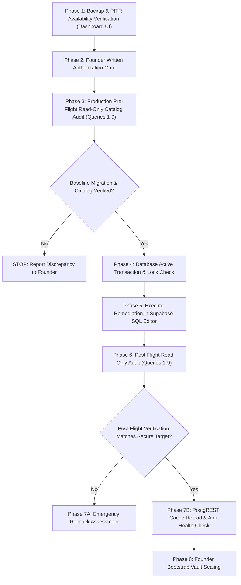

# ZEBALPHA — PRODUCTION SUPABASE PRE-FLIGHT READ-ONLY AUDIT PLAN

**Document Version:** 3.0.0 (Forensic & Architectural Final Revision)  
**Target Environment:** Production Supabase Database  
**Current Git Main Commit:** `b604e9e9d352bdf0d7328055eb5216c020ab991c`  
**Classification:** HIGH-SECURITY ARCHITECTURAL FORENSIC PLAN  
**Status:** DRAFT / PENDING FOUNDER REVIEW (STRICTLY LOCAL — ZERO PRODUCTION ACCESS PERMITTED)

---

## 1. Executive Summary & Mandatory Safety Rules

This document establishes the verified pre-flight inspection protocol for the ZebAlpha Production Supabase database prior to deploying the enterprise multi-panel security remediation patch.

### Strict Safety Constraints:
1. **Local Repository Review Only:** This plan is generated and reviewed locally. NO connection to Production Supabase has been initiated.
2. **Zero Production Execution Without Prior Approval:** NO SQL statements (including read-only `SELECT` queries) shall be executed against Production until Backup/PITR verification is complete and explicit written Founder approval is granted.
3. **Zero Mutation & Zero Migration Execution:** Neither the forward migration nor the rollback script may be run during pre-flight.
4. **Zero Credential / Secret Exposure:** Passwords, database connection strings, service-role keys, JWT secrets, and bootstrap tokens MUST NOT be logged, printed, or queried in plaintext.
5. **Zero Query-Text Leakage:** Active session monitoring must inspect wait events, transaction age, and connection state only; running SQL query text must NEVER be queried to prevent leaking customer PII or authentication parameters.
6. **Strict Execution Order:** Backup verification and Founder approval MUST precede any Production SQL query execution.

---

## 2. Migration Artifacts, Concurrency & Deployment Role Analysis

### 2.1 Applied Baseline Migration
- **File:** `supabase/20261109_enterprise_multi_panel_ecosystem_migration.sql`
- **Registry Version:** `20261109_enterprise_multi_panel_ecosystem`
- **Baseline Scope:** Created 16 enterprise domain tables and `schema_migrations`, configured baseline indexes, helper functions, and initial table privileges.

### 2.2 Forward Security Remediation Migration
- **File:** `supabase/20261109_enterprise_multi_panel_security_remediation.sql`
- **Registry Version:** `20261109_enterprise_multi_panel_security_remediation`
- **Target Changes:** 
  - Restricts table privileges to least-privilege across all 16 business tables.
  - Enables RLS on `schema_migrations` and restricts management to `service_role`.
  - Hardens 12 functions with `SECURITY DEFINER` and trusted immutable search paths.
  - Revokes direct RPC `EXECUTE` privileges on 5 trigger functions from untrusted roles.
  - Enforces backend-only customer support ticket creation (removes client INSERT policy).
  - Implements Founder Bootstrap Vault TTL expiration, replay prevention, and row locking.

### 2.3 Advisory Lock Mechanics (Accurate Technical Clarification)
- **Lock Statement:**
  ```sql
  SELECT pg_advisory_xact_lock(hashtextextended('20261109_enterprise_multi_panel_security_remediation', 0));
  ```
- **Scope & Limitations:** 
  PostgreSQL transaction-level advisory locks are **cooperative application locks**. They serialize transactions that explicitly request the **same 64-bit advisory key**. 
  - **What it does:** Prevents concurrent, duplicate executions of this exact migration (e.g., if two deployment scripts or administrators execute the file concurrently).
  - **What it does NOT do:** It does NOT block unrelated concurrent DDL, general database writes, or independent migrations that do not query this lock key.

### 2.4 Deployment Role & Privilege Analysis
- **Expected Execution Role:** Executed via the Supabase Dashboard SQL Editor as role `postgres` (the table and schema owner).
- **Actual Privilege Requirements:**
  - `ALTER TABLE ... ENABLE ROW LEVEL SECURITY`, `ALTER TABLE ... ADD COLUMN`, `CREATE TRIGGER`, `CREATE POLICY`, `REVOKE`, `GRANT`: In PostgreSQL, these statements require **ownership of the target tables** (or membership in the table-owning role `postgres`).
  - `CREATE OR REPLACE FUNCTION`: Requires `CREATE` privilege on schema `public`.
  - `INSERT INTO public.schema_migrations`: Requires table `INSERT` privilege.
- **Clarification on Privileges:** 
  The migration does NOT require custom roles with global `BYPASSRLS` or `CREATEROLE`. It simply requires table ownership and schema creation privileges, which `postgres` inherently possesses.

### 2.5 PostgREST Schema Cache Reload Behavior
- PostgREST caches table schemas, column types, and function definitions in memory.
- While Supabase includes an internal DDL trigger that emits `NOTIFY pgrst, 'reload schema'`, network jitter or high load can delay or drop notifications.
- **Protocol:** Do NOT assume automatic reload. After applying the remediation DDL, administrators must manually verify API response or issue an explicit notify in SQL Editor:
  ```sql
  NOTIFY pgrst, 'reload schema';
  ```

---

## 3. Pre-Flight Query Inventory

The queries are partitioned into two distinct categories:
- **Part A:** Pure system-catalog queries that read only PostgreSQL internal metadata (`pg_catalog`, `information_schema`) and never touch application rows.
- **Part B:** Restricted application table queries that inspect application-level tracking tables without reading authentication secrets.

---

### PART A: Pure System-Catalog Metadata Inspection Queries

---

#### Query 1: Comprehensive Relation Existence, Type & RLS Status (17 Objects)
- **Classification:** Pure System Catalog Read (`pg_class`, `pg_namespace`).
- **Read-Only Safety:** Catalog metadata read; zero table locking or data access.
- **SQL:**
```sql
SELECT 
    t.expected_table,
    c.oid IS NOT NULL AS relation_exists,
    CASE c.relkind
        WHEN 'r' THEN 'Ordinary Table'
        WHEN 'p' THEN 'Partitioned Table (UNEXPECTED)'
        WHEN 'v' THEN 'View (UNEXPECTED)'
        WHEN 'm' THEN 'Materialized View (UNEXPECTED)'
        WHEN 'f' THEN 'Foreign Table (UNEXPECTED)'
        ELSE 'MISSING'
    END AS relation_type,
    COALESCE(c.relrowsecurity, false) AS rls_enabled,
    COALESCE(c.relforcerowsecurity, false) AS rls_forced
FROM (
    VALUES 
      ('departments'), ('employee_profiles'), ('user_app_memberships'),
      ('founder_bootstrap_vault'), ('employee_invitations'), ('media_campaigns'),
      ('creative_assets'), ('social_posts'), ('media_tasks'), ('operations_tasks'),
      ('customer_support_tickets'), ('internal_announcements'), ('notification_campaigns'),
      ('notification_suppression_list'), ('notification_delivery_audit_logs'),
      ('enterprise_audit_logs'), ('schema_migrations')
) AS t(expected_table)
LEFT JOIN pg_class c 
  ON c.relname = t.expected_table 
 AND c.relnamespace = 'public'::regnamespace
ORDER BY t.expected_table ASC;
```
- **What it reads:** Left-joins the static list of all 17 expected tables against `pg_class`. Decodes `c.relkind` to ensure every object is an ordinary table (`'r'`). If an object is a view or missing, it reports the exact type instead of silently omitting it.
- **Expected Pre-Remediation Result:** All 16 business tables report `Ordinary Table` and `rls_enabled = true`. `schema_migrations` reports `Ordinary Table` and `rls_enabled = false`.
- **Expected Post-Remediation Result:** All 17 tables report `Ordinary Table` and `rls_enabled = true`.
- **Missing-Object Handling:** If any row returns `relation_type = 'MISSING'` or an unexpected view type, STOP. The baseline schema is incomplete or corrupted.

---

#### Query 2: Unified RLS Policy Inventory (Deduplication & Scope Audit)
- **Classification:** Pure System Catalog Read (`pg_policies`).
- **Read-Only Safety:** Catalog view read.
- **SQL:**
```sql
SELECT 
    tablename,
    policyname,
    permissive,
    roles,
    cmd,
    qual IS NOT NULL AS has_using_clause,
    with_check IS NOT NULL AS has_with_check_clause
FROM pg_policies
WHERE schemaname = 'public'
  AND tablename IN (
    'employee_profiles', 'user_app_memberships', 'founder_bootstrap_vault',
    'employee_invitations', 'customer_support_tickets', 'enterprise_audit_logs',
    'internal_announcements', 'schema_migrations'
  )
ORDER BY tablename, cmd, policyname;
```
- **What it reads:** Consolidated list of all active RLS policies across enterprise tables, covering `employee_invitations`, `customer_support_tickets`, and `schema_migrations` in a single unified query.
- **Expected Pre-Remediation Result:**
  - `employee_invitations`: Exactly one policy "HR managers view invitations" (`cmd = SELECT`).
  - `customer_support_tickets`: Policies for `SELECT` and `UPDATE`. May contain legacy or draft client INSERT policies.
  - `schema_migrations`: Zero policies (`rls_enabled = false`).
- **Expected Post-Remediation Result:**
  - `customer_support_tickets`: Exactly two policies: "Customer and support view tickets" (`SELECT`) and "Support staff updates tickets" (`UPDATE`). ZERO policies with `cmd = 'INSERT'`.
  - `schema_migrations`: Exactly one policy: "Service role manages schema_migrations" (`FOR ALL TO service_role`).
  - `employee_invitations`: Only "HR managers view invitations" for `authenticated`.

---

#### Query 3: Table-Level Privilege & Raw ACL Audit
- **Classification:** Pure System Catalog Read (`information_schema.table_privileges` & `pg_class.relacl`).
- **Read-Only Safety:** Standard ANSI catalog view and raw catalog array inspection. Uses a correlated scalar subquery to prevent PostgreSQL 0A000 "cannot implement GROUP BY" error caused by mixing sortable types with hash-only `aclitem[]`.
- **SQL:**
```sql
SELECT 
    c.relname AS table_name,
    c.relacl::text AS raw_acl_array,
    COALESCE(
        (
            SELECT string_agg(DISTINCT tp.grantee || ': ' || tp.privilege_type, ', ' ORDER BY tp.grantee || ': ' || tp.privilege_type)
            FROM information_schema.table_privileges tp
            WHERE tp.table_name = c.relname
              AND tp.table_schema = 'public'
              AND tp.grantee IN ('PUBLIC', 'anon', 'authenticated')
        ), 
        'No direct grants to untrusted roles'
    ) AS untrusted_role_grants
FROM pg_class c
WHERE c.relnamespace = 'public'::regnamespace
  AND c.relname IN (
    'founder_bootstrap_vault', 'enterprise_audit_logs',
    'notification_delivery_audit_logs', 'schema_migrations',
    'customer_support_tickets', 'employee_invitations'
  )
ORDER BY c.relname;
```
- **Limitations of `table_privileges`:**
  ANSI `information_schema.table_privileges` only displays explicit grants to specific named roles. It does NOT automatically compute role inheritance (e.g. users inheriting via group roles) or superuser privileges. Inspecting `pg_class.relacl` directly reveals the exact PostgreSQL internal Access Control List.
- **Expected Post-Remediation Result:**
  - `founder_bootstrap_vault`: `No direct grants to untrusted roles`.
  - `enterprise_audit_logs`: `No direct grants to untrusted roles`.
  - `notification_delivery_audit_logs`: `No direct grants to untrusted roles`.
  - `schema_migrations`: `No direct grants to untrusted roles`.
  - `employee_invitations`: Only `authenticated: SELECT`.
  - `customer_support_tickets`: Only `authenticated: SELECT, UPDATE`. ZERO `INSERT`.

---

#### Query 4: Function Overload & Execution Privilege Audit
- **Classification:** Pure System Catalog Read (`pg_proc`, `pg_namespace`).
- **Read-Only Safety:** System catalog read.
- **SQL:**
```sql
SELECT 
    p.proname AS function_name,
    pg_get_function_identity_arguments(p.oid) AS argument_signature,
    p.prosecdef AS is_security_definer,
    p.proacl AS raw_function_acl,
    CASE 
        WHEN p.proacl IS NULL THEN 'DEFAULT: Executable by PUBLIC'
        WHEN p.proacl::text LIKE '%=X/public%' OR p.proacl::text LIKE '%=X/anon%' OR p.proacl::text LIKE '%=X/authenticated%' THEN 'VULNERABLE: Direct execution granted to untrusted roles'
        ELSE 'SECURE: Direct execution restricted'
    END AS execution_privilege_status
FROM pg_proc p
JOIN pg_namespace n ON n.oid = p.pronamespace
WHERE n.nspname = 'public'
  AND p.proname IN (
    'prevent_bootstrap_vault_tamper',
    'prevent_bootstrap_vault_deletion',
    'validate_employee_profile_mutation',
    'validate_support_ticket_mutation',
    'prevent_audit_log_mutation',
    'consume_founder_bootstrap_token'
  )
ORDER BY p.proname, argument_signature;
```
- **What it reads:** Queries `pg_proc` directly using `pg_get_function_identity_arguments(p.oid)`. This guarantees that overloaded functions with different signatures (such as the 3-argument baseline `consume_founder_bootstrap_token` vs the 4-argument remediation signature) are explicitly listed and never aggregated or missed.
- **Expected Pre-Remediation Result:** Baseline functions show `raw_function_acl IS NULL` (`DEFAULT: Executable by PUBLIC`). `consume_founder_bootstrap_token` has 3 arguments.
- **Expected Post-Remediation Result:** All 5 trigger functions and the 4-argument `consume_founder_bootstrap_token` report `SECURE: Direct execution restricted`.

---

#### Query 5: Function Security Model & Search Path Integrity
- **Classification:** Pure System Catalog Read (`pg_proc`, `pg_namespace`).
- **Read-Only Safety:** Catalog table read.
- **SQL:**
```sql
SELECT 
    p.proname AS function_name,
    pg_get_function_identity_arguments(p.oid) AS argument_signature,
    p.prosecdef AS is_security_definer,
    p.proconfig AS search_path_settings,
    CASE 
        WHEN p.prosecdef AND p.proconfig IS NULL THEN 'CRITICAL: SECURITY DEFINER missing fixed search_path'
        WHEN p.prosecdef AND p.proconfig::text LIKE '%search_path=public, auth%' THEN 'SECURE: Pinned to public, auth'
        WHEN p.prosecdef AND p.proconfig::text LIKE '%search_path=public%' THEN 'SECURE: Pinned to public'
        WHEN NOT p.prosecdef THEN 'INFO: SECURITY INVOKER (caller privileges apply)'
        ELSE 'VERIFY: Non-standard configuration'
    END AS security_assessment
FROM pg_proc p
JOIN pg_namespace n ON n.oid = p.pronamespace
WHERE n.nspname = 'public'
  AND p.proname IN (
    'check_is_enterprise_owner',
    'check_user_has_app_membership',
    'check_is_management_role',
    'check_is_app_manager',
    'is_active_employee',
    'get_auth_employee_dept_id',
    'prevent_bootstrap_vault_tamper',
    'prevent_bootstrap_vault_deletion',
    'consume_founder_bootstrap_token',
    'validate_employee_profile_mutation',
    'validate_support_ticket_mutation',
    'prevent_audit_log_mutation',
    'protect_employee_invitation_mutation',
    'validate_media_task_update',
    'validate_operations_task_update'
  )
ORDER BY p.proname, argument_signature;
```
- **Function Security Model Analysis:**
  - *Auth Helper Functions:* `check_is_enterprise_owner`, `check_user_has_app_membership`, `check_is_management_role`, `check_is_app_manager`, `is_active_employee`, `get_auth_employee_dept_id` must be `SECURITY DEFINER` with `search_path = public, auth` to evaluate `auth.uid()` and read `user_app_memberships` safely.
  - *Trigger Functions:* `prevent_bootstrap_vault_tamper`, `prevent_bootstrap_vault_deletion`, `validate_employee_profile_mutation`, `validate_support_ticket_mutation`, `prevent_audit_log_mutation` must be `SECURITY DEFINER` with `search_path = public` to enforce table invariants regardless of mutator role.
  - *Baseline Retained Functions:* `protect_employee_invitation_mutation`, `validate_media_task_update`, `validate_operations_task_update` are retained from baseline with `search_path = public`.
- **Expected Post-Remediation Result:** Zero rows reporting `CRITICAL`. All remediation functions show `SECURE: Pinned`.

---

#### Query 6: Customer Support Ticket Dual-Layer Security Proof
- **Classification:** Pure System Catalog Read (`information_schema.table_privileges` + `pg_policies`).
- **Read-Only Safety:** Catalog view read.
- **SQL:**
```sql
SELECT 
    'Table Grant' AS check_type,
    grantee AS role_name,
    privilege_type AS attribute
FROM information_schema.table_privileges
WHERE table_schema = 'public'
  AND table_name = 'customer_support_tickets'
  AND privilege_type = 'INSERT'
  AND grantee IN ('PUBLIC', 'anon', 'authenticated')

UNION ALL

SELECT 
    'RLS Policy' AS check_type,
    roles::text AS role_name,
    policyname AS attribute
FROM pg_policies
WHERE schemaname = 'public'
  AND tablename = 'customer_support_tickets'
  AND cmd = 'INSERT';
```
- **Dual-Layer Defense-in-Depth Explanation:**
  1. *Layer 1 (Table Grants):* In PostgreSQL, if `INSERT` is not granted on `customer_support_tickets` to role `authenticated`, any direct SQL `INSERT` is rejected immediately with `permission denied`.
  2. *Layer 2 (RLS Policies):* Even if an attacker somehow bypasses table privileges, RLS default-deny blocks inserts unless an explicit `cmd = 'INSERT'` policy allows it.
  3. *Verification Mandate:* Both queries MUST return ZERO rows to prove that direct client inserts are blocked at both layers.
- **Expected Secure Result:** ZERO rows returned.

---

#### Query 7: Active Trigger Inventory & State Verification (Source-Confirmed Names)
- **Classification:** Pure System Catalog Read (`pg_trigger`, `pg_proc`, `pg_class`).
- **Read-Only Safety:** Catalog read.
- **SQL:**
```sql
SELECT 
    c.relname AS table_name,
    t.tgname AS trigger_name,
    p.proname AS function_name,
    t.tgenabled AS trigger_status_flag,
    CASE t.tgenabled
        WHEN 'O' THEN 'Enabled (Normal / Origin Sessions)'
        WHEN 'A' THEN 'Enabled (Always - Origin & Replica)'
        WHEN 'R' THEN 'WARNING: Enabled on Replica Only (WILL NOT FIRE on Primary!)'
        WHEN 'D' THEN 'CRITICAL: Trigger is DISABLED'
        ELSE 'Unknown'
    END AS trigger_operational_state
FROM pg_trigger t
JOIN pg_class c ON c.oid = t.tgrelid
JOIN pg_proc p ON p.oid = t.tgfoid
WHERE c.relnamespace = 'public'::regnamespace
  AND c.relname IN (
    'founder_bootstrap_vault', 'employee_profiles',
    'customer_support_tickets', 'enterprise_audit_logs',
    'notification_delivery_audit_logs', 'employee_invitations',
    'media_tasks', 'operations_tasks'
  )
  AND NOT t.tgisinternal
ORDER BY c.relname, t.tgname;
```
- **Exact Source-Confirmed Trigger Names & State Inventory:**
  - *Baseline Pre-Flight Inventory (8 triggers expected across the 8 inspected tables):*
    - `employee_invitations`: `trg_protect_employee_invitation_mutation` (BEFORE UPDATE)
    - `media_tasks`: `trg_validate_media_task_update` (BEFORE UPDATE)
    - `operations_tasks`: `trg_validate_operations_task_update` (BEFORE UPDATE)
    - `customer_support_tickets`: `trg_validate_support_ticket_mutation` (BEFORE UPDATE)
    - `founder_bootstrap_vault`: `trg_prevent_bootstrap_tamper` (BEFORE UPDATE), `trg_prevent_bootstrap_delete` (BEFORE DELETE OR TRUNCATE)
    - `enterprise_audit_logs`: `trg_prevent_audit_log_mutation` (BEFORE UPDATE OR DELETE)
    - `notification_delivery_audit_logs`: `trg_prevent_delivery_log_mutation` (BEFORE UPDATE OR DELETE)
    - `employee_profiles`: 0 triggers (Baseline has no mutation trigger; field protection trigger is added in remediation).
  - *Post-Remediation Inventory (11 triggers expected across the 8 inspected tables):*
    - `employee_profiles`: `trg_validate_employee_profile_mutation` (Added at line 402)
    - `enterprise_audit_logs`: `trg_prevent_audit_log_mutation`, `trg_prevent_audit_log_truncate` (Truncate trigger added at line 468)
    - `notification_delivery_audit_logs`: `trg_prevent_delivery_log_mutation`, `trg_prevent_delivery_log_truncate` (Truncate trigger added at line 477)
    - `founder_bootstrap_vault`: `trg_prevent_bootstrap_tamper`, `trg_prevent_bootstrap_delete` (Updated lines 228 & 246)
    - `customer_support_tickets`: `trg_validate_support_ticket_mutation` (Updated line 442)
    - `employee_invitations`, `media_tasks`, `operations_tasks`: Retained baseline triggers.
- **Replica vs Origin Status:** Every trigger MUST display `Enabled (Normal / Origin Sessions)` (`tgenabled = 'O'`). If any trigger shows `'R'` or `'D'`, it will not fire on the production primary database!

---

### PART B: Restricted Application Table Inspection Queries

---

#### Query 8: Applied Migration History (`schema_migrations`)
- **Classification:** Application Metadata Inspection (Compile-Safe via `to_regclass`).
- **Read-Only Safety:** Uses `to_regclass` to prevent PostgreSQL 42P01 syntax error if the baseline migration has not yet been applied.
- **SQL:**
```sql
SELECT 
    'schema_migrations' AS inspected_object,
    to_regclass('public.schema_migrations') IS NOT NULL AS table_exists,
    CASE 
        WHEN to_regclass('public.schema_migrations') IS NOT NULL THEN 'Table exists. Run: SELECT version, applied_at, applied_by FROM public.schema_migrations;'
        ELSE 'BASELINE MIGRATION NOT YET APPLIED: public.schema_migrations has not been created on this database.'
    END AS diagnostic_status;
```
- **What it reads:** Checks whether `schema_migrations` exists and displays its status without crashing if absent. If present, run `SELECT version, applied_at, applied_by FROM public.schema_migrations ORDER BY applied_at DESC;`.
- **Expected Pre-Remediation Result:** Confirms whether baseline ecosystem migration was previously applied.
- **Expected Post-Remediation Result:** Both baseline and remediation migration rows exist.

---

#### Query 9A: Founder Bootstrap Vault Catalog & Trigger Pre-Check (Pure Catalog — 100% Safe)
- **Classification:** Pure System Catalog Read (`pg_class`, `pg_attribute`, `pg_index`, `pg_trigger`).
- **Read-Only Safety:** 100% compile-time and runtime safe even if `founder_bootstrap_vault` is absent.
- **SQL:**
```sql
SELECT 
    c.oid IS NOT NULL AS table_exists,
    EXISTS (
        SELECT 1 FROM pg_attribute a 
        WHERE a.attrelid = c.oid AND a.attname = 'expires_at' AND NOT a.attisdropped
    ) AS has_expires_at_column,
    EXISTS (
        SELECT 1 FROM pg_index i 
        JOIN pg_class ic ON ic.oid = i.indexrelid 
        WHERE i.indrelid = c.oid AND ic.relname = 'uq_founder_bootstrap_single_row'
    ) AS has_single_row_unique_index,
    (
        SELECT COUNT(*) FROM pg_trigger t 
        WHERE t.tgrelid = c.oid 
          AND t.tgname IN ('trg_prevent_bootstrap_tamper', 'trg_prevent_bootstrap_delete')
          AND t.tgenabled = 'O'
    ) AS active_tamper_triggers_count
FROM (SELECT 1) _
LEFT JOIN pg_class c 
  ON c.relname = 'founder_bootstrap_vault' 
 AND c.relnamespace = 'public'::regnamespace;
```
- **Safety Guarantee:** Uses catalog joins only. If `founder_bootstrap_vault` does not exist, `table_exists` returns `false` with ZERO runtime errors.

---

#### Query 9B: Founder Bootstrap Vault Status (Guarded Application Read — Zero Secrets)
- **Classification:** **[RESTRICTED APPLICATION DATA READ — RUN ONLY IF QUERY 9A CONFIRMS TABLE EXISTS]**
- **Read-Only Safety & Baseline Schema Independence:** 
  In the pre-flight baseline state (before remediation is deployed), the `expires_at` column does NOT exist in `public.founder_bootstrap_vault`. Referencing `expires_at` in baseline pre-flight will cause PostgreSQL to abort with `ERROR: column "expires_at" does not exist`. 
  Therefore, Query 9B is cleanly divided into a **Baseline Pre-Flight Safe Query** and a **Post-Remediation Verification Query**.
- **Pre-Flight SQL (Baseline Safe):**
```sql
SELECT 
    COUNT(*) AS total_rows,
    COALESCE(BOOL_AND(is_locked), false) AS is_locked,
    COALESCE(BOOL_AND(consumed_at IS NOT NULL), false) AS is_consumed
FROM public.founder_bootstrap_vault;
```
- **Post-Remediation SQL (Run only after remediation adds `expires_at`):**
```sql
SELECT 
    COUNT(*) AS total_rows,
    COALESCE(BOOL_AND(is_locked), false) AS is_locked,
    COALESCE(BOOL_AND(consumed_at IS NOT NULL), false) AS is_consumed,
    COALESCE(BOOL_AND(expires_at IS NOT NULL), false) AS has_expiration_configured,
    COALESCE(BOOL_AND(expires_at < NOW()), false) AS is_expired
FROM public.founder_bootstrap_vault;
```
- **What it reads:** Aggregate status flags (`total_rows`, `is_locked`, `is_consumed`). Zero secrets (`token_hash`, `founder_email`, `consumed_ip`) or timestamps are read.
- **Expected Pre-Remediation Result:** `total_rows` is 0 (unseeded) or 1; `is_locked` matches baseline status.
- **Expected Post-Remediation Result:** Structural columns exist; boolean status confirms lock and expiration status without exposing secrets.

---

## 4. Dependencies & Sequential Execution Order



### Detailed Sequence:
1. **Phase 1 (Backup Verification):** In Supabase Dashboard, confirm automated daily backup status is `Completed` and PITR is `Active`.
2. **Phase 2 (Founder Written Approval):** Obtain explicit, written Founder sign-off before initiating any connection to Production.
3. **Phase 3 (Pre-Flight Audit):** Execute Queries 1 through 9B sequentially in Supabase SQL Editor to document the baseline state.
4. **Phase 4 (Session Check):** Inspect active sessions for blocking transactions.
5. **Phase 5 (Atomic Execution):** Run `supabase/20261109_enterprise_multi_panel_security_remediation.sql` inside a single execution block.
6. **Phase 6 (Post-Flight Audit):** Re-run Queries 1 through 9B. Confirm all 17 tables have RLS, trigger execution privileges are revoked from PUBLIC, and `schema_migrations` is shielded.
7. **Phase 7 (PostgREST Reload & App Health):** Execute `NOTIFY pgrst, 'reload schema';` and verify panel authentication flows.
8. **Phase 8 (Founder Sealing):** Founder invokes `/api/founder/bootstrap` to establish root identity and permanently lock the vault.

---

## 5. Rollback Limitations, Asymmetric Restoration & Operational Risks

### 5.1 What the Rollback Script Restores
- Reverts helper functions to baseline definitions.
- Restores 3-argument signature of `consume_founder_bootstrap_token` and drops 4-argument signature.
- Drops remediation-specific triggers: `trg_validate_employee_profile_mutation`, `trg_prevent_audit_log_truncate`, `trg_prevent_delivery_log_truncate`.
- Restores baseline table privileges (`authenticated` SELECT on `enterprise_audit_logs`).
- Restores baseline `schema_migrations` state: RLS disabled, `service_role` granted ALL, `PUBLIC/anon/authenticated` revoked.
- Restores default execution privileges on baseline functions.
- Removes version `'20261109_enterprise_multi_panel_security_remediation'` from `public.schema_migrations`.

### 5.2 Asymmetric Retained Objects (Safe Delta)
- **`founder_bootstrap_vault.expires_at` column:** Retained as a nullable column. Dropping columns on active tables acquires `ACCESS EXCLUSIVE` table locks and may block production queries.
- **`uq_founder_bootstrap_single_row` unique index:** Retained because enforcing single-row integrity is beneficial regardless of remediation state.
- **Zero Business Data Deletion:** Rollback does NOT delete audit logs, memberships, or profiles.

### 5.3 Critical Operational Warning: Rollback Restores Weaker Baseline Security
> [!WARNING]
> **Rollback is an emergency disaster recovery mechanism, NOT a secure steady state.**
> Executing the rollback restores several known baseline weaknesses:
> 1. `schema_migrations` has Row Level Security disabled again.
> 2. Baseline trigger functions have direct `EXECUTE` privileges restored to `PUBLIC`.
> 3. Employee profiles lose trigger-level column protection (`validate_employee_profile_mutation` is dropped).
> 4. Customer support tickets remain backend-only (the client INSERT policy is purged in both forward and rollback scripts).

---

## 6. Backup & PITR Verification Checklist

Before connecting to Production or running any SQL:

### 6.1 Supabase Dashboard Backup Verification (No 60-Minute Assumption)
- [ ] Navigate to **Project Settings** $\rightarrow$ **Database** $\rightarrow$ **Backups**.
- [ ] **Scheduled Daily Backups:** Verify that automated daily backups are active and the most recent backup status is `Completed` (typically completed within the last 24 hours).
- [ ] **Point-In-Time Recovery (PITR):**
  - Verify that PITR is enabled for the project (Pro / Team / Enterprise tier).
  - Verify that the PITR status is `Active` and continuous WAL archiving is healthy.
  - Note the earliest restorable time and the current UTC time.
- [ ] **Logical Dump Limitations & Sensitive Data Protection:**
  - If taking a logical snapshot via `supabase db dump` or `pg_dump`:
    - *Limitation 1:* A logical dump is NOT point-in-time; any writes occurring during or after the dump are lost upon restore.
    - *Limitation 2:* Restoring a logical dump requires schema teardown, creating extended downtime.
    - *Limitation 3:* A logical dump contains sensitive customer data, password hashes, and schema definitions. It MUST be encrypted at rest, stored in a private, access-controlled bucket, and purged after the maintenance window. NEVER store production dumps on developer machines.

### 6.2 Active Session & Lock Inspection (Safe Zero-Query-Text Read)
Inspect active transactions and locks without exposing query text or PII:
```sql
SELECT 
    pid, 
    usename, 
    client_addr, 
    state, 
    wait_event_type, 
    wait_event, 
    now() - xact_start AS transaction_duration,
    now() - query_start AS current_statement_duration
FROM pg_stat_activity 
WHERE state IN ('active', 'idle in transaction')
  AND pid <> pg_backend_pid()
  AND xact_start IS NOT NULL
ORDER BY transaction_duration DESC;
```
- **Safety Note:** This query uses `xact_start` (which accurately measures transaction age for both active and `idle in transaction` sessions) and intentionally OMITS the `query` text column to prevent exposing sensitive SQL statements or customer data.

---

## 7. Supabase Dashboard UI vs. SQL Catalog Inspection Matrix

| Verification Item | Supabase Dashboard UI Method | SQL Catalog Inspection Method |
| :--- | :--- | :--- |
| **RLS Status on Tables** | **Table Editor** $\rightarrow$ Select Table $\rightarrow$ Look for green "RLS ENABLED" badge. | **Query 1** (`pg_class.relrowsecurity`) |
| **Active RLS Policies** | **Authentication** $\rightarrow$ **Policies** $\rightarrow$ Expand Table name $\rightarrow$ Review policy cards. | **Query 2** (`pg_policies`) |
| **Applied Migrations** | **Table Editor** $\rightarrow$ `schema_migrations` $\rightarrow$ Inspect rows. | **Query 8** (`schema_migrations`) |
| **Table Grants (Privileges)** | Not directly exposed in Dashboard UI. | **Query 3** (`table_privileges` & `relacl`) |
| **Function Execution Rights** | **Database** $\rightarrow$ **Functions** (shows definitions, but not ACLs). | **Query 4** (`pg_proc.proacl`) |
| **Security Definer Search Path**| **Database** $\rightarrow$ **Functions** $\rightarrow$ Click Function $\rightarrow$ Inspect definition. | **Query 5** (`pg_proc.proconfig`) |
| **Customer Support INSERT** | **Authentication** $\rightarrow$ **Policies** (verify no INSERT policy). | **Query 6** (Dual-layer grant + policy) |
| **Trigger Active/Disabled State**| **Database** $\rightarrow$ **Triggers** (displays triggers, but not exact flag).| **Query 7** (`pg_trigger.tgenabled`) |
| **Founder Vault Integrity** | **Table Editor** $\rightarrow$ `founder_bootstrap_vault` (shows columns & count). | **Query 9A & 9B** (Guarded read) |
| **Backups & PITR Status** | **Project Settings** $\rightarrow$ **Database** $\rightarrow$ **Backups** (Primary check). | Dashboard Infrastructure UI |

---

## 8. Unresolved Assumptions Requiring DBA / Founder Review

Before proceeding, the Founder and DBA must review and validate the following architectural assumptions:

1. **Deployment Role Identity:** It is assumed the migration will be executed by role `postgres` via the Supabase SQL Editor. If an alternate automated deployment role is used, verify it owns the target tables.
2. **PostgREST Schema Cache:** Confirm post-migration execution of `NOTIFY pgrst, 'reload schema';` to prevent stale endpoint caches.
3. **Customer Support Ticket Ingestion:** Confirm that all frontend clients (Customer Web App and Mobile App) create tickets exclusively via the backend API (`/api/support/tickets`) and that NO frontend component attempts direct client-side Supabase INSERT.
4. **Founder Bootstrap Timing:** Confirm that the Founder is available to run `/api/founder/bootstrap` shortly after migration to seal the vault with an initialized owner account.

---

## 9. Final Gate & Founder Approval Protocol

```text
================================================================================
                            CRITICAL GATEWAY (STOP)
================================================================================
This pre-flight verification plan is 100% READ-ONLY and PREPARATORY.
NO DATABASE CONNECTIONS HAVE BEEN INITIATED.
NO SQL STATEMENTS HAVE BEEN EXECUTED AGAINST PRODUCTION.

STOP CONDITION:
Wait for explicit, written Founder authorization before initiating any connection
or executing Queries 1 through 9B in the Supabase SQL Editor.
================================================================================
```
