# ZEBALPHA — ENTERPRISE SECURITY MIGRATION REVIEW & DEPLOYMENT SPECIFICATION

**Document Version:** 2.0.0 (Forensic & Architectural Audit — Final Validated Revision)  
**File Under Review:** `supabase/20261109_enterprise_multi_panel_security_remediation.sql`  
**Git Baseline Commit:** `b604e9e9d352bdf0d7328055eb5216c020ab991c`  
**Target Environment:** Production Supabase Database  
**Author:** Senior Enterprise Security Architect & Database Security Engineer  
**Classification:** HIGH-SECURITY ARCHITECTURAL FORENSIC REVIEW  
**Status:** COMPLETE / AWAITING FOUNDER MIGRATION APPROVAL  

---

## 1. Executive Summary & Review Objectives

This document provides a comprehensive, statement-by-statement architectural and security review of `supabase/20261109_enterprise_multi_panel_security_remediation.sql`. 

### Key Verification Goals:
1. **Transaction Encapsulation & Abort Safety:** Verify atomic execution boundaries (`BEGIN; ... COMMIT;`) and transactional DDL rollback behavior.
2. **Concurrency & Advisory Lock Safety:** Audit `pg_advisory_xact_lock` behavior and concurrency boundaries.
3. **Migration History Upsert Audit:** Analyze `ON CONFLICT (version) DO UPDATE SET applied_at = NOW();` and its forensic effects on audit timestamps.
4. **PostgreSQL Lock Level Accuracy:** Provide 100% technically rigorous classifications of table and catalog lock levels according to PostgreSQL documentation.
5. **Execution Privileges & Role Analysis:** Confirm the necessary database role privileges to execute the migration.
6. **Object Dependency Graph:** Map the dependency hierarchy across tables, helper functions, triggers, and RLS policies.
7. **PostgREST Schema Cache Handling:** Define mandatory cache reload protocols.

---

## 2. Structural & Architectural Analysis

### 2.1 Transaction Boundaries & Error Atomicity
- **Enclosure:** The migration is fully encapsulated between `BEGIN;` (line 12) and `COMMIT;` (line 665).
- **PostgreSQL Transactional DDL:** Unlike databases that commit after each DDL statement (e.g. MySQL, Oracle), PostgreSQL executes DDL within transactions. If ANY statement encounters an error (e.g., column does not exist, syntax error, lock timeout, constraint violation), PostgreSQL immediately marks the transaction as aborted (`ERROR: current transaction is aborted, commands ignored until end of transaction block`).
- **Atomicity Guarantee:** All preceding schema, trigger, and policy changes within the transaction block are discarded upon abort, ensuring zero partial DDL state.
- **Execution Caveat:** This atomicity guarantee holds ONLY if the entire migration script is submitted as a single unified block. If an operator highlights individual statements or runs in an autocommit-enabled GUI, partial execution can occur.

### 2.2 Advisory Lock Mechanics
- **Statement (line 17):**
  ```sql
  SELECT pg_advisory_xact_lock(hashtextextended('20261109_enterprise_multi_panel_security_remediation', 0));
  ```
- **Type:** Transaction-scoped exclusive 64-bit advisory lock.
- **Scope:** Coordinates transactions that explicitly request the exact same 64-bit integer key (`hashtextextended('20261109_enterprise_multi_panel_security_remediation', 0)`).
- **Protection Provided:** Prevents concurrent duplicate execution of this specific migration (e.g. if two CI/CD jobs or administrators run the file simultaneously).
- **Limitation:** Does NOT block unrelated DDL, general application writes, or independent migrations that do not query this advisory key.
- **Release:** Automatically released when the enclosing transaction commits or aborts. Zero manual cleanup required.

### 2.3 Migration Version Tracking & Upsert Timestamp Impact
- **Statement (lines 22-27):**
  ```sql
  INSERT INTO public.schema_migrations (version, description)
  VALUES (
      '20261109_enterprise_multi_panel_security_remediation',
      'Hardened forensic security patch: least privilege, app isolation, policy deduplication, atomic bootstrap'
  )
  ON CONFLICT (version) DO UPDATE SET applied_at = NOW();
  ```
- **Detailed Forensic Behavior Analysis:**
  1. *First Run:* The version does not exist in `public.schema_migrations`. A new row is inserted with `applied_at = NOW()` and `applied_by = CURRENT_USER`.
  2. *Subsequent Runs (Idempotency):* If the migration is executed again, the unique primary key constraint on `version` triggers the `ON CONFLICT (version)` branch.
  3. *Timestamp Mutation Effect:* `DO UPDATE SET applied_at = NOW()` explicitly updates the `applied_at` column to the timestamp of the *latest re-execution*. 
  4. *Forensic Consequence:* The original deployment timestamp is overwritten with the re-run timestamp. In contrast, `applied_by` is NOT updated, retaining the original executor username.
  5. *Audit Trail Safeguard:* The permanent, immutable audit trail is independently recorded in `public.enterprise_audit_logs`, which possesses anti-tamper triggers (`BEFORE UPDATE OR DELETE RAISE EXCEPTION`) and cannot be overwritten.

### 2.4 Deployment Role & Execution Privileges
- **Target Execution Tool:** Supabase Dashboard SQL Editor or Supabase CLI deployment runner.
- **Execution Role:** Role `postgres` (the table and schema owner).
- **Required Privileges:**
  - `ALTER TABLE ... ENABLE ROW LEVEL SECURITY`: Requires table ownership.
  - `ALTER TABLE ... ADD COLUMN IF NOT EXISTS`: Requires table ownership (`AccessExclusiveLock`).
  - `CREATE TRIGGER ... ON ...`: Requires table ownership.
  - `DROP POLICY / CREATE POLICY`: Requires table ownership.
  - `CREATE OR REPLACE FUNCTION`: Requires `CREATE` privilege on schema `public`.
  - `GRANT / REVOKE`: Requires table/function ownership or `GRANT OPTION`.
- **Verdict:** Role `postgres` owns all tables in `public` schema and has full schema `CREATE` privileges. Custom roles with global `BYPASSRLS` or `CREATEROLE` are not required.

### 2.5 PostgREST Schema Cache Reload Behavior
- PostgREST serves Supabase REST endpoints using an in-memory schema cache.
- While Supabase uses internal DDL event triggers to fire `NOTIFY pgrst, 'reload schema'`, high concurrency or network load may delay cache invalidation.
- **Deployment Requirement:** Immediately following successful migration commit, administrators must execute:
  ```sql
  NOTIFY pgrst, 'reload schema';
  ```

---

## 3. Statement-by-Statement Classification & Precise PostgreSQL Lock Analysis

Each statement in the migration is classified into one of four categories:
1. **Safe to Repeat:** Purely idempotent; can be executed multiple times without failure or behavioral alteration.
2. **Conditionally Repeatable:** Safe if dependencies exist; replaces existing definitions (`CREATE OR REPLACE`, `DROP ... IF EXISTS`).
3. **Not Safely Repeatable:** May cause errors, duplicate data, or unexpected state transitions if repeated outside a clean transaction.
4. **Requires DBA Review:** Statements that acquire strong database locks or alter core security semantics.

### Technical PostgreSQL Lock Levels:
- **`RowExclusiveLock` on system catalogs (`pg_proc`, `pg_class`, `pg_attribute`):** Acquired when modifying catalog rows.
- **`AccessExclusiveLock` on object:** Acquired when creating/replacing/dropping functions, dropping triggers, altering tables, or creating/dropping RLS policies.
- **`ShareLock` on table:** Acquired when creating an index without `CONCURRENTLY`. Blocks concurrent `INSERT`/`UPDATE`/`DELETE`, allows `SELECT`.
- **`ShareRowExclusiveLock` on table:** Acquired by `CREATE TRIGGER`. Blocks concurrent data modifications and DDL.
- **`AccessShareLock` on table:** Acquired by `GRANT`/`REVOKE` on tables (catalog modification in `pg_class` takes `RowExclusiveLock`).

| Line Range | SQL Operation / Target | Classification | Exact PostgreSQL Lock Level Acquired | Repeatability & Operational Risk Notes |
| :--- | :--- | :--- | :--- | :--- |
| **12** | `BEGIN;` | Safe to Repeat | None | Opens transaction block. |
| **17** | `SELECT pg_advisory_xact_lock(...)` | Safe to Repeat | Advisory (Exclusive 64-bit) | Serializes concurrent migration attempts. Zero table lock. |
| **22-27** | `INSERT INTO public.schema_migrations ... ON CONFLICT DO UPDATE` | Safe to Repeat | `RowExclusiveLock` on `schema_migrations` | Upserts version tag. Updates `applied_at` on conflict. |
| **34-49** | `CREATE OR REPLACE FUNCTION check_is_enterprise_owner()` | Conditionally Repeatable | `RowExclusiveLock` on `pg_proc`; `AccessExclusiveLock` on function OID | Replaces existing function. Zero user-table lock. |
| **52-76** | `CREATE OR REPLACE FUNCTION check_user_has_app_membership()` | Conditionally Repeatable | `RowExclusiveLock` on `pg_proc`; `AccessExclusiveLock` on function OID | Replaces existing function. Zero user-table lock. |
| **79-89** | `CREATE OR REPLACE FUNCTION check_is_management_role()` | Conditionally Repeatable | `RowExclusiveLock` on `pg_proc`; `AccessExclusiveLock` on function OID | Deprecates unscoped management role. Pinned search path. |
| **92-132** | `CREATE OR REPLACE FUNCTION check_is_app_manager()` | Conditionally Repeatable | `RowExclusiveLock` on `pg_proc`; `AccessExclusiveLock` on function OID | App-scoped manager verification. Pinned search path. |
| **135-148**| `CREATE OR REPLACE FUNCTION is_active_employee()` | Conditionally Repeatable | `RowExclusiveLock` on `pg_proc`; `AccessExclusiveLock` on function OID | Pinned search path. Replaces existing function. |
| **151-166**| `CREATE OR REPLACE FUNCTION get_auth_employee_dept_id()` | Conditionally Repeatable | `RowExclusiveLock` on `pg_proc`; `AccessExclusiveLock` on function OID | Pinned search path. Replaces existing function. |
| **171-188**| `REVOKE ALL ... FROM PUBLIC, anon; GRANT ... TO authenticated, service_role;` | Safe to Repeat | `RowExclusiveLock` on `pg_proc`; `AccessExclusiveLock` on function OID | Idempotent ACL updates on 6 helper functions. |
| **194-195**| `ALTER TABLE public.founder_bootstrap_vault ADD COLUMN IF NOT EXISTS expires_at TIMESTAMPTZ;` | Requires DBA Review | `AccessExclusiveLock` on `founder_bootstrap_vault` | In PG11+, adding nullable column with no default is catalog-only (instantaneous). |
| **198-199**| `CREATE UNIQUE INDEX IF NOT EXISTS uq_founder_bootstrap_single_row ON founder_bootstrap_vault ((TRUE));` | Requires DBA Review | `ShareLock` on `founder_bootstrap_vault` | Enforces single-row constraint. Fails if table has $>1$ existing rows. Pre-flight Query 9A/9B confirms row count. |
| **202-228**| `CREATE OR REPLACE FUNCTION prevent_bootstrap_vault_tamper()` | Conditionally Repeatable | `RowExclusiveLock` on `pg_proc`; `AccessExclusiveLock` on function OID | Anti-tamper trigger function. Pinned `search_path = public`. |
| **230-234**| `DROP TRIGGER IF EXISTS ...; CREATE TRIGGER trg_prevent_bootstrap_tamper ...` | Conditionally Repeatable | `AccessExclusiveLock` on `DROP`; `ShareRowExclusiveLock` on `CREATE` on `founder_bootstrap_vault` | Recreates update trigger atomically. |
| **237-246**| `CREATE OR REPLACE FUNCTION prevent_bootstrap_vault_deletion()` | Conditionally Repeatable | `RowExclusiveLock` on `pg_proc`; `AccessExclusiveLock` on function OID | Anti-deletion trigger function. Pinned `search_path = public`. |
| **248-251**| `DROP TRIGGER IF EXISTS ...; CREATE TRIGGER trg_prevent_bootstrap_delete ...` | Conditionally Repeatable | `AccessExclusiveLock` on `DROP`; `ShareRowExclusiveLock` on `CREATE` on `founder_bootstrap_vault` | Recreates delete/truncate trigger atomically. |
| **254-367**| `CREATE OR REPLACE FUNCTION consume_founder_bootstrap_token(VARCHAR, VARCHAR, VARCHAR, UUID)` | Conditionally Repeatable | `RowExclusiveLock` on `pg_proc`; `AccessExclusiveLock` on function OID | 4-argument atomic bootstrap procedure with `FOR UPDATE` lock and inline provisioning. |
| **370** | `DROP FUNCTION IF EXISTS consume_founder_bootstrap_token(VARCHAR, VARCHAR, VARCHAR);` | Safe to Repeat | `RowExclusiveLock` on `pg_proc`; `AccessExclusiveLock` on function OID | Drops obsolete 3-argument baseline signature. |
| **373-374**| `REVOKE ALL ...; GRANT EXECUTE ... TO service_role;` | Safe to Repeat | `RowExclusiveLock` on `pg_proc`; `AccessExclusiveLock` on function OID | Exclusive service-role invocation for bootstrap token consumer. |
| **380-404**| `CREATE OR REPLACE FUNCTION validate_employee_profile_mutation(); CREATE TRIGGER ...` | Conditionally Repeatable | `AccessExclusiveLock` on `DROP`; `ShareRowExclusiveLock` on `CREATE` on `employee_profiles` | Field-level protection trigger for employee profiles. |
| **410-444**| `CREATE OR REPLACE FUNCTION validate_support_ticket_mutation(); CREATE TRIGGER ...` | Conditionally Repeatable | `AccessExclusiveLock` on `DROP`; `ShareRowExclusiveLock` on `CREATE` on `customer_support_tickets` | Enforces support executive mutation rules. Blocks direct customer update. |
| **450-479**| `CREATE OR REPLACE FUNCTION prevent_audit_log_mutation(); CREATE TRIGGERS ...` | Conditionally Repeatable | `AccessExclusiveLock` on `DROP`; `ShareRowExclusiveLock` on `CREATE` on `enterprise_audit_logs`, `notification_delivery_audit_logs` | Anti-tamper and anti-truncate triggers on audit logs. |
| **484-495**| `REVOKE ALL ON FUNCTION ... FROM PUBLIC, anon, authenticated; GRANT ... TO service_role;` | Safe to Repeat | `RowExclusiveLock` on `pg_proc`; `AccessExclusiveLock` on function OID | Restricts direct invocation of 5 trigger functions to `service_role`. |
| **501-511**| `ALTER TABLE schema_migrations ENABLE RLS; REVOKE/GRANT; CREATE POLICY` | Requires DBA Review | `AccessExclusiveLock` on `schema_migrations` | Shields migration registry from client inspection/tampering. |
| **514-530**| `REVOKE ALL ON TABLE ... FROM public, anon;` (16 tables) | Safe to Repeat | `AccessShareLock` on relation; `RowExclusiveLock` on `pg_class` | Strips all default table privileges from public and unauthenticated roles. |
| **532-547**| `GRANT ALL ON TABLE ... TO service_role;` (16 tables) | Safe to Repeat | `AccessShareLock` on relation; `RowExclusiveLock` on `pg_class` | Re-establishes explicit backend management rights. |
| **550-562**| `GRANT SELECT / INSERT / UPDATE ON TABLE ... TO authenticated;` | Safe to Repeat | `AccessShareLock` on relation; `RowExclusiveLock` on `pg_class` | Enforces least-privilege matrix on authenticated role. Direct INSERT withheld on `customer_support_tickets`. |
| **568-594**| `DROP POLICY IF EXISTS ...; CREATE POLICY ... ON employee_profiles` | Conditionally Repeatable | `AccessExclusiveLock` on `employee_profiles` | Deduplicates employee profile policies. Replaces with owner/HR/self policy. |
| **597-634**| `DROP POLICY IF EXISTS ...; CREATE POLICY ... ON customer_support_tickets` | Conditionally Repeatable | `AccessExclusiveLock` on `customer_support_tickets` | Replaces support ticket policies with owner/support staff/customer read rules. |
| **640** | `DROP POLICY IF EXISTS "Customers create support tickets" ON customer_support_tickets;` | Safe to Repeat | `AccessExclusiveLock` on `customer_support_tickets` | Purges client INSERT policy without recreation. Direct INSERT is permanently denied. |
| **643-650**| `DROP POLICY IF EXISTS ...; CREATE POLICY ... ON user_app_memberships` | Conditionally Repeatable | `AccessExclusiveLock` on `user_app_memberships` | Restricts membership visibility to self and enterprise owner. |
| **652-663**| `DROP POLICY IF EXISTS ...; CREATE POLICY ... ON internal_announcements` | Conditionally Repeatable | `AccessExclusiveLock` on `internal_announcements` | Restricts announcements by active employment and department/scope. |
| **665** | `COMMIT;` | Safe to Repeat | None | Flushes all changes to disk atomically. |

---

## 4. Object Dependency Graph

```mermaid
flowchart TD
    subgraph Foundation ["0. Foundation & Infrastructure"]
        MIG["schema_migrations"]
        LOCK["Advisory Lock (64-bit)"]
    end

    subgraph AuthHelpers ["1. Hardened Auth Functions (public, auth)"]
        OWNER["check_is_enterprise_owner()"]
        MEM["check_user_has_app_membership()"]
        MGR["check_is_app_manager()"]
        MGMT["check_is_management_role()"]
        EMP["is_active_employee()"]
        DEPT["get_auth_employee_dept_id()"]
    end

    subgraph Triggers ["2. Anti-Tamper & Mutation Triggers (public)"]
        TRG_VAULT["prevent_bootstrap_vault_tamper()"]
        TRG_V_DEL["prevent_bootstrap_vault_deletion()"]
        TRG_EMP["validate_employee_profile_mutation()"]
        TRG_TKT["validate_support_ticket_mutation()"]
        TRG_AUDIT["prevent_audit_log_mutation()"]
    end

    subgraph Tables ["3. Protected Enterprise Tables"]
        T_VAULT["founder_bootstrap_vault"]
        T_EMP["employee_profiles"]
        T_MEM["user_app_memberships"]
        T_TKT["customer_support_tickets"]
        T_AUDIT["enterprise_audit_logs"]
        T_ANNC["internal_announcements"]
    end

    subgraph Policies ["4. Hardened RLS Policies"]
        POL_EMP["Employee views / updates own profile"]
        POL_TKT["Customer and support view / update tickets"]
        POL_MEM["User views own memberships"]
        POL_ANNC["Scoped announcements visibility"]
        POL_MIG["Service role manages schema_migrations"]
    end

    LOCK --> Foundation
    OWNER --> MEM
    OWNER --> MGR
    OWNER --> MGMT
    OWNER --> EMP
    
    MEM --> POL_EMP
    OWNER --> POL_EMP
    TRG_EMP --> T_EMP
    
    OWNER --> POL_TKT
    MEM --> POL_TKT
    MGR --> POL_TKT
    TRG_TKT --> T_TKT
    
    OWNER --> POL_MEM
    EMP --> POL_ANNC
    DEPT --> POL_ANNC
    
    TRG_VAULT --> T_VAULT
    TRG_V_DEL --> T_VAULT
    TRG_AUDIT --> T_AUDIT
    
    POL_MIG --> MIG
```



### Dependency Rules Verified:
1. **Functions Precede Policies:** All 6 helper functions are defined in Section 1 before any RLS policies in Section 8 reference them.
2. **Trigger Functions Precede Triggers:** Trigger functions (`prevent_bootstrap_vault_tamper`, `validate_employee_profile_mutation`, etc.) are declared before the corresponding `CREATE TRIGGER` statements.
3. **Table Columns Precede Triggers:** Column `expires_at` is added to `founder_bootstrap_vault` before the anti-tamper trigger references `NEW.expires_at`.
4. **Obsolete Functions Cleaned:** The 3-argument `consume_founder_bootstrap_token` is dropped after the 4-argument replacement is created.

---

## 5. Potential Failure Modes & Mitigation Strategies

| Risk / Failure Mode | Likelihood | Impact | Built-in Mitigation / Defense |
| :--- | :--- | :--- | :--- |
| **Concurrent Execution** | Low | High | `pg_advisory_xact_lock` serializes runs. |
| **Existing Multiple Vault Rows** | Very Low | Medium | `uq_founder_bootstrap_single_row` will fail if $>1$ row exists. Pre-flight Query 9A/9B confirms row count. |
| **Missing `departments` EXEC Row** | Very Low | Low | Procedure `consume_founder_bootstrap_token` checks `IF v_exec_dept_id IS NOT NULL` before inserting profile. |
| **PostgREST Stale Schema Cache** | Medium | Medium | Post-migration step mandates `NOTIFY pgrst, 'reload schema';`. |
| **Table Lock Timeout** | Low | Low | DDL operations run on low-volume tables with fast metadata operations. |

---

## 6. Verification Checklist for Migration Deployment

- [ ] Git commit verified as `b604e9e9d352bdf0d7328055eb5216c020ab991c`.
- [ ] Automated backup completed within last 24 hours.
- [ ] PITR verified active in Supabase Dashboard.
- [ ] Pre-flight Queries 1–9B executed with zero discrepancies.
- [ ] Founder written approval obtained.
- [ ] PostgREST cache reload command prepared.
